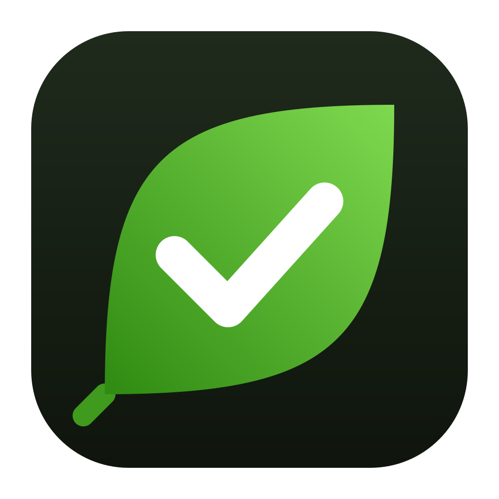
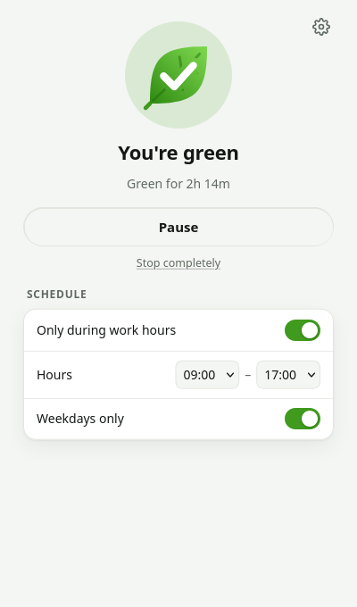
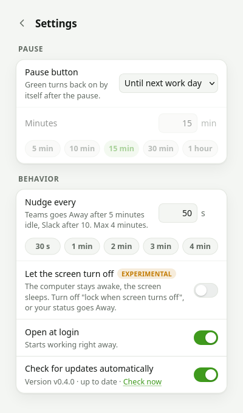
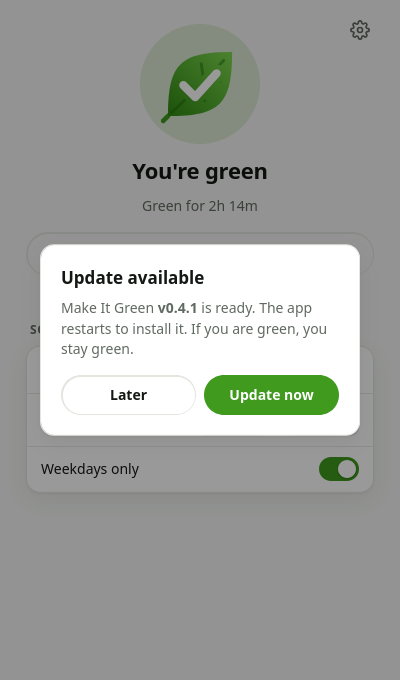

<div align="center">



# Make It Green

**Stay Available in Microsoft Teams and Active in Slack, without touching your mouse.**

[](https://github.com/raticulous/make-it-green/releases/latest)




</div>

## Why

Teams marks you Away after about 5 idle minutes. Slack does the same after about 10.
Reading a long document, sitting in a call on another device or thinking through a problem is still work.
Make It Green keeps your status green and keeps the computer awake while you do it.

It works with the Teams and Slack desktop apps and with Teams in the browser or as a PWA.
You do not configure anything per app.

## Features

- **One button.** Click **Keep me green** and your status stays green.
- **Pause when you step away.** Pause until the next work day, or for 5, 10, 15, 30 or 60 minutes.
  Green turns back on by itself after the pause.
- **Stop completely.** The app stays off, also at the next login, until you turn it on again.
- **Work hours.** Keep green only inside your hours, and only on weekdays if you want.
- **Tray icon.** A green leaf means green, a yellow leaf means paused, a grey leaf means off.
- **Open at login.** The app starts working when you log in.
- **Screen can sleep** (experimental). The computer stays awake and the screen turns off.
- **Updates itself.** The app finds new versions and asks before it installs them.

<p align="center">
  
  &nbsp;&nbsp;
  
</p>

## Download

| System | File |
|---|---|
| Windows 10/11 (x64) | [make-it-green-windows-amd64.zip](https://github.com/raticulous/make-it-green/releases/latest/download/make-it-green-windows-amd64.zip) |
| macOS (Apple silicon and Intel) | [make-it-green-macos-universal.zip](https://github.com/raticulous/make-it-green/releases/latest/download/make-it-green-macos-universal.zip) |
| Linux (x64) | [make-it-green-linux-amd64.tar.gz](https://github.com/raticulous/make-it-green/releases/latest/download/make-it-green-linux-amd64.tar.gz) |

**Windows**

1. Unzip the file to a folder you own, for example `Documents\Make It Green`.
2. Run `make-it-green-gui.exe`. If SmartScreen warns you, click **More info → Run anyway**. The app is not code-signed.

**macOS**

1. Unzip the file and move **Make It Green.app** to **Applications**.
2. The first time, right-click the app and choose **Open**. The app is not notarized.
3. Allow it in **System Settings → Privacy & Security → Accessibility**. The app needs this permission to move the mouse.

**Linux**

1. Unpack the file to a folder you own, for example `~/Apps/make-it-green`.
2. Run `./make-it-green-gui`. The app adds itself to your app launcher.
3. Install the tool for your session:
   - X11: install `xdotool`.
   - Wayland: install `ydotool`, add your user to the `input` group, then run `systemctl --user enable --now ydotool`.

Keep the app in a folder your user can write to. The app cannot update itself in a system folder such as `/usr/bin`.

## Questions

**Can the screen turn off while I stay green?**
Yes, with the experimental **Let the screen turn off** setting.
The computer stays awake, and the app turns the screen off again after each nudge.
Turn off "lock the screen when it turns off" in your system settings. A locked screen makes Teams and Slack show Away.

**Can the computer sleep while I stay green?**
No. A sleeping computer has no network connection, so Teams and Slack disconnect.
Teams or Slack on your phone keeps you green when the computer sleeps.

**Does it change anything in Teams or Slack?**
No. It moves the mouse by 1 pixel and back, which both apps count as activity.
It does not log in anywhere, read messages or need an account.
Its only network request is the update check to GitHub, which you can turn off.

---

# Technical details

## How it works

- Every N seconds (default 50, max 240) the engine moves the mouse 1 px and back.
- While green, it holds an OS sleep lock:
  - Windows: `SetThreadExecutionState`
  - macOS: `caffeinate`
  - Linux: `systemd-inhibit`
- The nudge tool depends on the system:
  - Linux X11: `xdotool`.
  - Linux Wayland: `ydotool`. It writes to `/dev/uinput`, so native Wayland apps also see the move, for example the Teams PWA in Edge or Chrome.
  - Windows: `SendInput`. macOS: `CGEvent`.
- Screen-off mode holds only the "system awake" lock and turns the display off after each nudge:
  - Windows: `SC_MONITORPOWER`
  - macOS: `pmset displaysleepnow`
  - Linux: `kscreen-doctor`, Mutter D-Bus or `xset`
- A pause saves its end time as wall-clock time in the settings file. A pause therefore also ends after a restart or after laptop sleep.

## Project layout

| Path | What it is |
|---|---|
| `engine/` | The shared engine: settings, schedule, pause, nudge, sleep lock, autostart. One file per OS. |
| `cmd/make-it-green/` | The CLI. |
| `cmd/make-it-green-gui/` | The desktop app: [Wails v2](https://wails.io) with a plain HTML/CSS/JS UI in `frontend/index.html`, tray menu, updater. |
| `assets/icons/` | Icon sources. `CONCEPT.md` explains the design. |

The CLI and the desktop app read and write the same settings file. `make-it-green status` prints its path.

## CLI

```
make-it-green                 keep green now, ignore work hours (Ctrl+C to stop)
make-it-green schedule        keep green only inside work hours
make-it-green -interval 60    seconds between nudges
make-it-green -screen-off     experimental: let the display sleep
make-it-green autostart on    run "make-it-green schedule" at login
make-it-green status          show the settings file and autostart state
```

## Build

```sh
# CLI (Linux and Windows need no cgo; macOS needs the Xcode command line tools)
go build -o make-it-green ./cmd/make-it-green

# Desktop app
go install github.com/wailsapp/wails/v2/cmd/wails@v2.17.0
cd cmd/make-it-green-gui && wails build -skipbindings   # Linux: add -tags webkit2_41

# Desktop app without the Wails CLI (Linux)
go build -tags desktop,production,webkit2_41 -o dist/make-it-green-gui ./cmd/make-it-green-gui

go test ./...
```

Build requirements:

| System | Needs |
|---|---|
| Linux | `libgtk-3-dev`, `libwebkit2gtk-4.1-dev` |
| macOS | Xcode command line tools |
| Windows | WebView2 runtime (included in Windows 10/11) |

## Releases

Push a `v*` tag. `.github/workflows/release.yml` then builds all three systems and publishes a GitHub release.
The macOS app is ad-hoc signed only.

```sh
git tag -a v0.4.1 -m v0.4.1 && git push origin v0.4.1
```

The workflow writes the tag into the app with `-ldflags "-X main.version=<tag>"`.
Builds without a version tag report `dev` and never update.

## Updates

- One minute after start, and then every 6 hours, the desktop app reads the latest release from the GitHub API.
- If that release is newer, the app shows its window with an **Update available** dialog. It asks once per version.
- **Update now** does these steps:
  1. Downloads the file for this OS.
  2. Checks the file against the SHA-256 digest that GitHub publishes.
  3. Unpacks the file next to the install.
  4. Swaps only the files that are already installed: the GUI, the CLI or the macOS `.app` bundle.
  5. Restarts the app. If the app was green, it stays green.
- On Windows the running `.exe` is renamed, not overwritten. The app deletes the old copy at its next start.
- **Settings → Check for updates automatically** turns the check off. **Check now** runs it at once.
